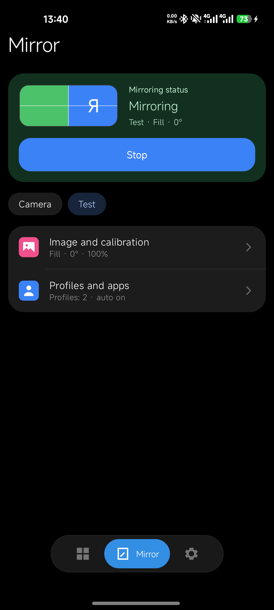
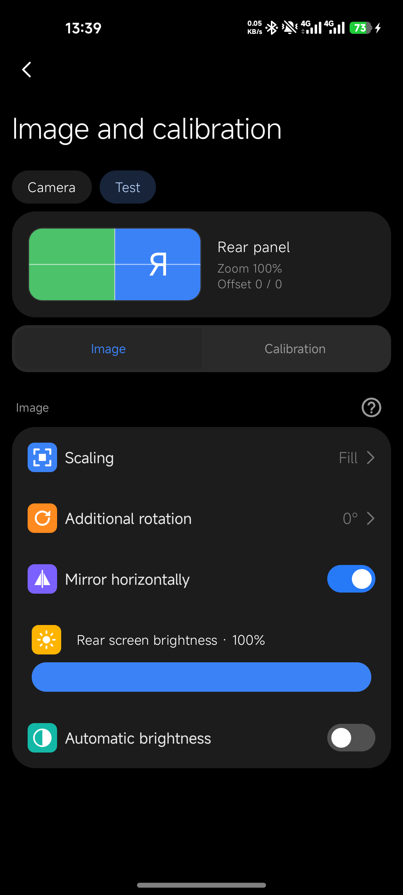
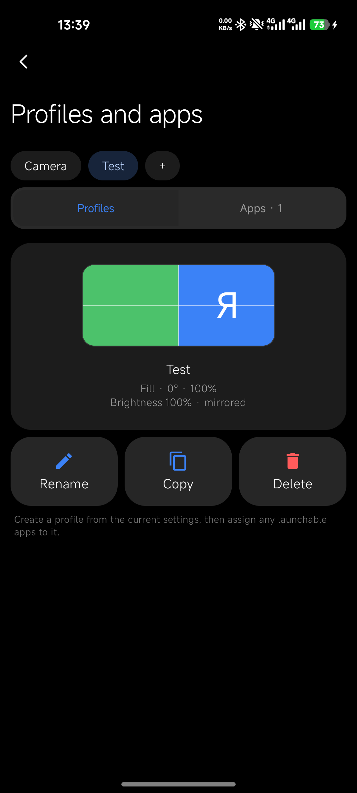
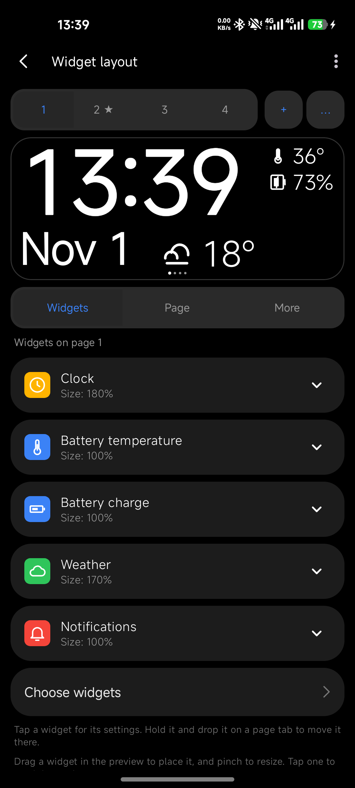
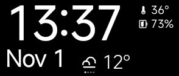

# Mirror2RearUltra

**English** · [Русский](README.ru.md)

Rear-screen mirroring, calibration and widget dashboard for the **Xiaomi Mi 11 Ultra**.

The app is built for this one phone and its 294 × 126 rear panel. Other devices are not tested and not supported.

> **This branch (`HyperOS4`) is adapted for HyperOS 4.**

<p align="center">
  
  
  
  
</p>

<p align="center">
  
  <br>
  <sub>The rear panel running a dashboard page.</sub>
</p>

## Contents

- [Features](#features)
- [Requirements](#requirements)
- [HyperOS 4: LSPosed module required](#hyperos-4-lsposed-module-required)
- [Installation](#installation)
- [Usage](#usage)
- [Permissions](#permissions)
- [Root](#root)
- [Building](#building)
- [Troubleshooting](#troubleshooting)
- [Known issues](#known-issues)

## Features

### Mirroring
- Quick Settings tile and a floating button for starting and stopping mirroring.
- **Silent capture:** mirroring without the system confirmation dialog. It starts only from the floating button and releases the capture 1.5 seconds after it is no longer needed.
- Camera, navigation, video and user-created profiles, each with independent settings.
- Fit, fill and stretch scaling; 0/90/180/270° rotation; horizontal mirroring.
- Per-profile rear brightness, zoom and horizontal/vertical offset.
- Adaptive sharp projection: 1× at 100% zoom, 1.5× at 105–150%, 2× at 155–200%. Economy mode stays at 1×.
- Rule-of-thirds grid and a level over the mirrored camera.
- Countdown on the panel before a shot taken by tapping it.
- Merged Mirror screen with profiles, an apps page and a page-slide transition.

### Profiles and apps
- Assign apps to profiles and switch profiles automatically when an assigned app opens.
- Rear output pauses and resumes for assigned apps during a mirroring session.

### Dashboard
- Dashboard-only, mirror-only and hybrid modes; several pages with automatic paging.
- Widget layout editor with a live preview: drag to move, pinch to resize, per-widget settings and sample variants.
- Widgets: clock and date (with variants), battery level, battery temperature, charging and time left, weather, next alarm, current media, notifications, calendar (ongoing events and more), compass, GPS speed and altitude, steps (kept across reboots), sunrise and sunset, horizon level, sound mode, world clocks and second time zone, QR code, Bluetooth and Wi-Fi, session time, active profile and custom text.
- Severity colours for temperature and battery, and a configurable colour style, text size and background opacity.
- Optional notification text on the panel, notification rings, and lighting the panel for a notification while the main screen is off.
- Bluetooth and Wi-Fi triggers.
- OLED burn-in drift.
- Quiet hours for the rear display.

### Protection and diagnostics
- Configurable temperature and low-battery protection with recovery hysteresis.
- Live status of root access, rear-backlight support, battery level and temperature.
- Calibration grid during mirroring and a 30-second rear-display test pattern.
- Versioned settings backup and restore through the system file picker.

## Requirements

- Xiaomi Mi 11 Ultra (rear panel 294 × 126).
- Android 11 or newer (`minSdk 30`). This branch targets HyperOS 4.
- **HyperOS 4: the [Rear Unlock LSPosed module](#hyperos-4-lsposed-module-required) and root access for LSPosed/Vector.** Without it the app cannot use the rear screen.
- Root is otherwise optional; see [Root](#root).

## HyperOS 4: LSPosed module required

**On HyperOS 4 the app has no access to the rear screen without the M2RU Rear Unlock module.** The firmware refuses to start any app on the rear display (displayId 1) unless the app is on its built-in whitelist, and a normal app cannot add itself to it. Mirroring, the dashboard and every widget depend on that access, so without the module nothing is shown on the panel.

The module (`com.n4r.rearunlock`, version 1.2.0) is a small LSPosed/Vector module. It hooks `system_server` at runtime and changes nothing on disk: no framework file or partition is patched.

What it does:
- Lets **only** `com.tpkarras.mirror2rearultra` start on the rear display, including while the main screen is locked. It overrides two firmware checks in `ActivityStarterImpl`: `isShouldShowOnRearDisplay` and `isAllowedToStartOnRearDisplay`. Every other app keeps the firmware's original answer.
- Fixes rear power handling on the tested firmware, where the legacy rear wake and sleep calls are empty. Calls from the app's own UID are forwarded to the current rear power group, and while the app's session is alive the rear panel does not follow the main screen's power key. Stopping the session or killing the app releases it.
- Writes a load stamp, `<module versionCode>:<boot count>`, to the secure setting `m2ru_rearunlock_stamp` once the system is up, so the app can tell that the module is really loaded and not just installed. A stamp from an earlier boot does not count.
- Does not dismiss the keyguard and does not grant screen-capture consent.

Setup:
1. Install LSPosed or Vector (this needs root). Then install `Mirror2RearUltra-RearUnlock-module.apk` from the same [Releases](../../releases) page as the app. Its source is in [`rearunlock/`](rearunlock/).
2. In LSPosed/Vector enable **M2RU Rear Unlock** and set its scope to **System Framework** (`system`, user 0).
3. Reboot. A changed module only loads into the system process after a reboot.
4. Check the LSPosed/Vector log for the `[M2RU-rear] hooked ...` lines. An enabled module and a saved scope alone do not prove it loaded.

To roll back, disable the module and reboot; there is nothing to undo in the firmware.

The module was verified on a Mi 11 Ultra (`star`) running Android 17 (API 37): the rear panel showed the dashboard with the main screen locked, and single and double taps worked. Other firmware builds may have different class or method names; in that case the module logs the failure and does nothing.

## Installation

Download `Mirror2RearUltra-<version>.apk` from the repository's Releases page, or [build it yourself](#building). On HyperOS 4 also install the Rear Unlock module from the same release (see above).

## Usage

1. Open the app and set up your profiles on the **Mirror** tab.
2. Add the Quick Settings tile and press it to start mirroring. Home-screen shortcuts must be allowed in the app's permissions for the tile to appear.
3. Build the dashboard on the widgets tab: pick widgets, arrange them on pages and set their sizes.
4. Turn MIUI power saver off for the app, so the system does not kill it.

Automatic profiles need Usage Access. Dashboard-only mode does not capture the main screen and does not ask for screen-sharing consent.

## Permissions

| Permission | Used for |
|---|---|
| Screen capture (per session) | Mirroring the main screen to the rear panel |
| Usage Access | Switching profiles by the foreground app |
| Display over other apps | The floating start button and overlays |
| Notification access | Notification widget and rings |
| Calendar | Calendar widget |
| Location (coarse and fine) | GPS speed and altitude, sunrise and sunset |
| Physical activity | Steps widget |
| Bluetooth (connect) | Bluetooth trigger and widget |
| Network and Wi-Fi state | Wi-Fi trigger, widget and weather |
| Internet | Weather |
| Foreground service | Keeping mirroring and the dashboard alive |

Weather uses the city entered in settings and does not request location.

## Root

| Feature | Without root | With root |
|---|---|---|
| Mirroring and dashboard | Works | Works |
| Rear brightness | Software dimming of the rear output only | Controls the physical rear backlight |
| Main-screen brightness | Never changed | Never changed |

## Building

```bash
./gradlew assembleDebug
```

The module is built separately: run `./gradlew assembleRelease` inside `rearunlock/`. The Gradle plugin needs JDK 11 or newer. If the system Java is older, point `JAVA_HOME` at a newer JDK, for example the one bundled with Android Studio. Run the unit tests with `./gradlew testDebugUnitTest`.

## Troubleshooting

- **The tile does not appear:** allow home-screen shortcuts in the app's permissions.
- **Mirroring stops by itself:** turn off MIUI power saver and allow autostart for the app.
- **Automatic profiles do nothing:** grant Usage Access.
- **The backlight flickers when the phone is held upright:** the system rear-screen service also controls the backlight; the app pauses it for the length of a session.

## Known issues

- Without the [Rear Unlock module](#hyperos-4-lsposed-module-required) the system refuses to start the app on the rear display on HyperOS 4. With the module this also works on a locked screen.

## Special thanks

1. Xiaomi for making the Mi 11 Ultra.
2. Google for providing the tools necessary to make this.
3. And you for downloading the app; without you, this app would never have existed.
