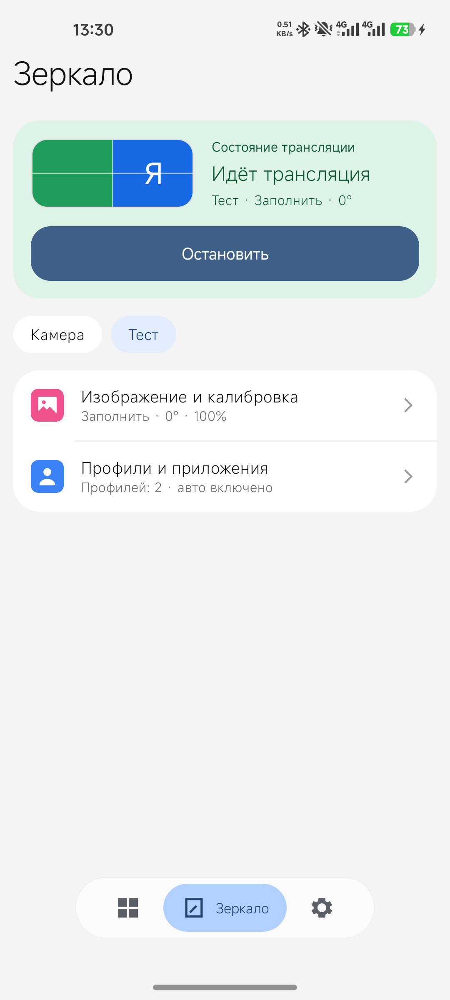
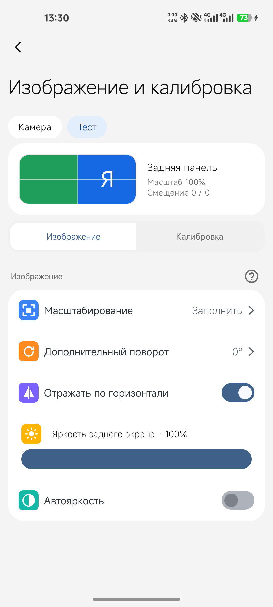
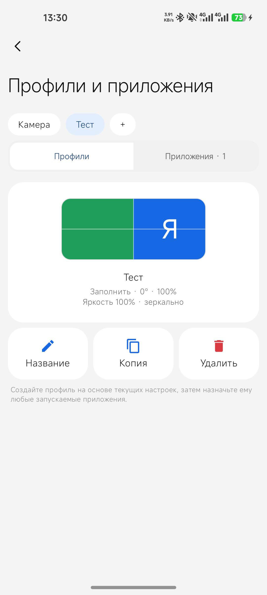
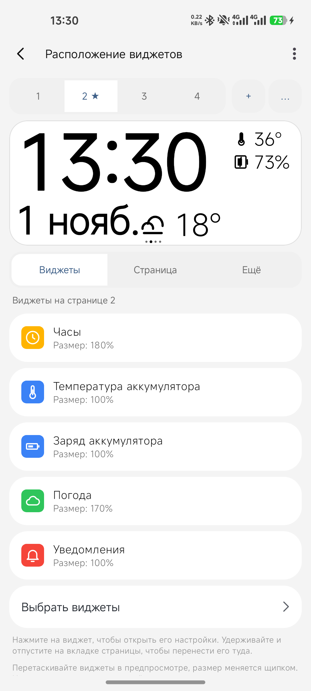
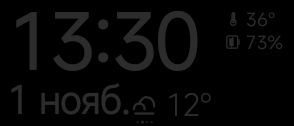

# Mirror2RearUltra

[English](README.md) · **Русский**

Зеркалирование на задний экран, калибровка и панель виджетов для **Xiaomi Mi 11 Ultra**.

Приложение сделано для одного телефона и его заднего экрана 294 × 126. Другие устройства не проверялись и не поддерживаются.

> **Эта ветка (`HyperOS4`) адаптирована под HyperOS 4.**

<p align="center">
  
  
  
  
</p>

<p align="center">
  
  <br>
  <sub>Задний экран с одной из страниц панели.</sub>
</p>

## Содержание

- [Возможности](#возможности)
- [Требования](#требования)
- [HyperOS 4: нужен модуль LSPosed](#hyperos-4-нужен-модуль-lsposed)
- [Установка](#установка)
- [Использование](#использование)
- [Разрешения](#разрешения)
- [Root](#root)
- [Сборка](#сборка)
- [Если что-то не работает](#если-что-то-не-работает)
- [Известные проблемы](#известные-проблемы)

## Возможности

### Зеркалирование
- Плитка быстрых настроек и плавающая кнопка для запуска и остановки зеркалирования.
- **Тихий захват:** зеркалирование без системного диалога подтверждения. Запускается только с плавающей кнопки и отпускает захват через 1,5 секунды после того, как он перестал быть нужен.
- Профили для камеры, навигации, видео и свои собственные, у каждого независимые настройки.
- Масштабирование «Вписать», «Заполнить» и «Растянуть»; поворот на 0/90/180/270°; отражение по горизонтали.
- Яркость заднего экрана, масштаб и смещение по горизонтали и вертикали для каждого профиля.
- Адаптивная чёткая проекция: 1× при масштабе 100%, 1,5× при 105–150%, 2× при 155–200%. В экономном режиме всегда 1×.
- Сетка по правилу третей и уровень поверх зеркала камеры.
- Отсчёт на панели перед снимком, сделанным касанием.
- Объединённый экран «Зеркало» с профилями, страницей приложений и плавной сменой страниц.

### Профили и приложения
- Назначайте приложения профилям: профиль переключается автоматически, когда открывается назначенное приложение.
- Вывод на задний экран приостанавливается и возобновляется для назначенных приложений во время сеанса зеркалирования.

### Панель виджетов
- Режимы «только панель», «только зеркало» и «гибрид»; несколько страниц с автоматической сменой.
- Редактор расположения виджетов с живым предпросмотром: перетаскивание, изменение размера щипком, настройки каждого виджета и варианты-образцы.
- Виджеты: часы и дата (с вариантами), заряд аккумулятора, температура аккумулятора, зарядка и оставшееся время, погода, ближайший будильник, текущее медиа, уведомления, календарь (текущие события и «ещё»), компас, скорость и высота по GPS, шаги (сохраняются после перезагрузки), восход и закат, уровень, режим звука, мировые часы и второй часовой пояс, QR-код, Bluetooth и Wi-Fi, время сеанса, активный профиль и произвольный текст.
- Цвета по степени важности для температуры и заряда; настраиваемый цвет оформления, размер текста и прозрачность фона.
- Необязательный текст уведомлений на панели, кольца уведомлений и подсветка панели при уведомлении, пока основной экран выключен.
- Триггеры по Bluetooth и Wi-Fi.
- Смещение изображения против выгорания OLED.
- Тихие часы для заднего экрана.

### Защита и диагностика
- Настраиваемая защита по температуре и низкому заряду с гистерезисом восстановления.
- Состояние root, подсветки заднего экрана, заряда и температуры в реальном времени.
- Калибровочная сетка во время зеркалирования и 30-секундная тестовая картинка заднего экрана.
- Резервная копия и восстановление настроек с версией через системный выбор файла.

## Требования

- Xiaomi Mi 11 Ultra (задний экран 294 × 126).
- Android 11 или новее (`minSdk 30`). Эта ветка рассчитана на HyperOS 4.
- **HyperOS 4: [модуль Rear Unlock для LSPosed](#hyperos-4-нужен-модуль-lsposed) и root для LSPosed/Vector.** Без него приложение не может использовать задний экран.
- В остальном root необязателен; см. [Root](#root).

## HyperOS 4: нужен модуль LSPosed

**На HyperOS 4 у приложения нет доступа к заднему экрану без модуля M2RU Rear Unlock.** Прошивка не запускает на заднем дисплее (displayId 1) ничего, кроме приложений из встроенного белого списка, а обычное приложение не может добавить себя в него. Зеркалирование, панель и все виджеты зависят от этого доступа, поэтому без модуля на панели ничего не появится.

Модуль (`com.n4r.rearunlock`, версия 1.1.0) — небольшой модуль LSPosed/Vector. Он перехватывает методы в `system_server` во время работы и ничего не меняет на диске: файлы фреймворка и разделы не патчатся.

Что он делает:
- Разрешает запуск на заднем дисплее **только** `com.tpkarras.mirror2rearultra`, в том числе при заблокированном основном экране. Для этого он переопределяет две проверки прошивки в `ActivityStarterImpl`: `isShouldShowOnRearDisplay` и `isAllowedToStartOnRearDisplay`. Остальные приложения получают прежний ответ прошивки.
- Исправляет питание заднего экрана на проверенной прошивке, где старые вызовы включения и выключения заднего экрана пустые. Вызовы от UID приложения пересылаются в актуальную группу питания заднего экрана, а пока сеанс приложения жив, задний экран не следует за кнопкой питания основного. Остановка сеанса или завершение процесса приложения снимают это.
- Не снимает блокировку экрана и не выдаёт согласие на захват экрана.

Настройка:
1. Установите LSPosed или Vector (нужен root). Затем установите `Mirror2RearUltra-RearUnlock-module.apk` со страницы [Releases](../../releases), откуда вы берёте приложение. Исходники модуля лежат в [`rearunlock/`](rearunlock/).
2. В LSPosed/Vector включите **M2RU Rear Unlock** и выберите область действия **System Framework** (`system`, пользователь 0).
3. Перезагрузите телефон. Изменённый модуль загружается в системный процесс только после перезагрузки.
4. Найдите в журнале LSPosed/Vector строки `[M2RU-rear] hooked ...`. Включённого модуля и сохранённой области самих по себе недостаточно, чтобы считать, что он загрузился.

Чтобы откатить, отключите модуль и перезагрузите телефон: в прошивке откатывать нечего.

Модуль проверен на Mi 11 Ultra (`star`) с Android 17 (API 37): на заднем экране показывалась панель при заблокированном основном экране, одиночные и двойные касания работали. На других сборках прошивки названия классов и методов могут отличаться; тогда модуль запишет ошибку в журнал и ничего не сделает.

## Установка

Скачайте `Mirror2RearUltra-<версия>.apk` на странице Releases репозитория или [соберите приложение сами](#сборка). На HyperOS 4 из того же релиза установите ещё и модуль Rear Unlock (см. выше).

## Использование

1. Откройте приложение и настройте профили на вкладке **«Зеркало»**.
2. Добавьте плитку в быстрые настройки и нажмите её, чтобы включить зеркалирование. Чтобы плитка появилась, в разрешениях приложения должны быть разрешены ярлыки на домашнем экране.
3. Соберите панель на вкладке виджетов: выберите виджеты, расставьте их по страницам и задайте размеры.
4. Отключите для приложения экономию заряда MIUI, чтобы система его не закрывала.

Автоматические профили требуют доступа к статистике использования. Режим «только панель» не снимает основной экран и не запрашивает согласие на показ экрана.

## Разрешения

| Разрешение | Для чего |
|---|---|
| Захват экрана (на каждый сеанс) | Зеркалирование основного экрана на задний |
| Доступ к статистике использования | Переключение профилей по приложению на переднем плане |
| Поверх других приложений | Плавающая кнопка запуска и оверлеи |
| Доступ к уведомлениям | Виджет и кольца уведомлений |
| Календарь | Виджет календаря |
| Местоположение (приблизительное и точное) | Скорость и высота по GPS, восход и закат |
| Физическая активность | Виджет шагов |
| Bluetooth (подключение) | Триггер и виджет Bluetooth |
| Состояние сети и Wi-Fi | Триггер и виджет Wi-Fi, погода |
| Интернет | Погода |
| Служба переднего плана | Работа зеркалирования и панели в фоне |

Погода использует город из настроек и не запрашивает местоположение.

## Root

| Функция | Без root | С root |
|---|---|---|
| Зеркалирование и панель | Работает | Работает |
| Яркость заднего экрана | Программное затемнение только заднего вывода | Управляет физической подсветкой заднего экрана |
| Яркость основного экрана | Не меняется | Не меняется |

## Сборка

```bash
./gradlew assembleDebug
```

Модуль собирается отдельно: выполните `./gradlew assembleRelease` в папке `rearunlock/`. Плагину Gradle нужен JDK 11 или новее. Если системная Java старше, укажите в `JAVA_HOME` более новый JDK, например встроенный в Android Studio. Модульные тесты запускаются командой `./gradlew testDebugUnitTest`.

## Если что-то не работает

- **Плитка не появляется:** разрешите ярлыки на домашнем экране в разрешениях приложения.
- **Зеркалирование останавливается само:** отключите экономию заряда MIUI и разрешите приложению автозапуск.
- **Автоматические профили ничего не делают:** выдайте доступ к статистике использования.
- **Подсветка мигает, когда телефон стоит вертикально:** системная служба заднего экрана тоже управляет подсветкой; на время сеанса приложение её приостанавливает.

## Известные проблемы

- Без [модуля Rear Unlock](#hyperos-4-нужен-модуль-lsposed) система на HyperOS 4 не запускает приложение на заднем экране. С модулем это работает и при заблокированном экране.

## Благодарности

1. Xiaomi за Mi 11 Ultra.
2. Google за инструменты, с помощью которых это сделано.
3. И вам за то, что скачали приложение: без вас его бы не существовало.
